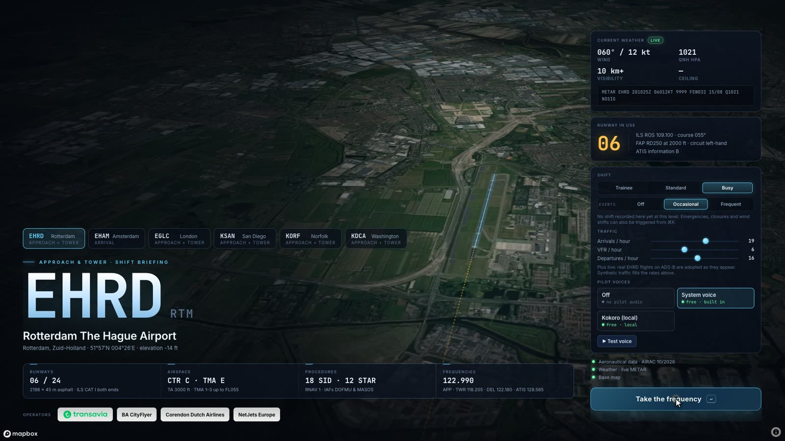
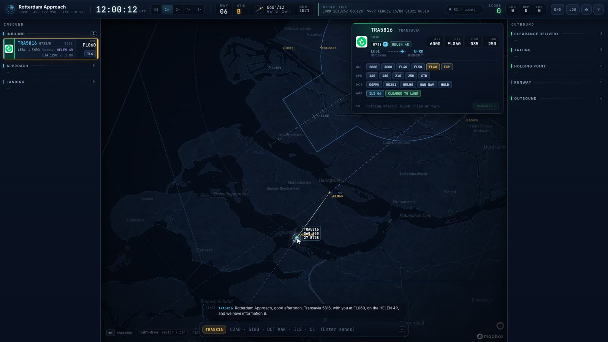
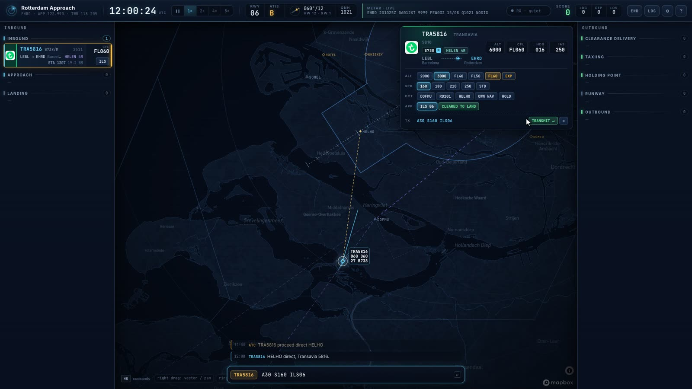
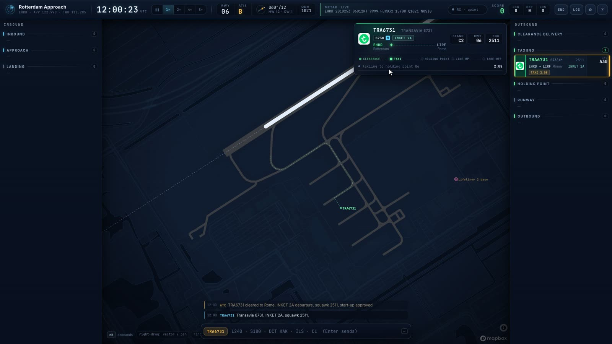
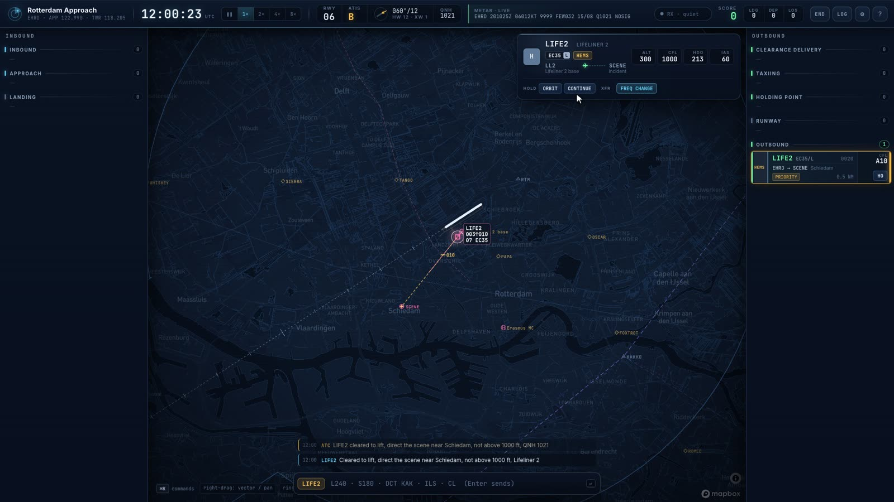

# Approach — a browser air traffic control game

Six airports with real procedures, live weather, live traffic, and pilots who read back your instructions in their own style.

| Airport | Your position | AI does |
|---|---|---|
| **EHRD** Rotterdam (`/`) | Approach + Tower combined: STAR → ILS → landing, clearance → take-off → hand-off; VFR general aviation via the reporting points; Lifeliner 2 along the A13 | — |
| **EHAM** Schiphol (`/?apt=EHAM`) | **Schiphol Arrival**: work the ARTIP/RIVER/SUGOL stacks onto the landing runways, transfer to Tower once established | Tower (landings, departures), Departure (SIDs) |
| **KSAN** San Diego (`/?apt=KSAN`) | **SoCal Approach** + San Diego Tower: one runway, LOC 27 at 3.5°, US phraseology | Center above you |
| **EGLC** London City (`/?apt=EGLC`) | **Thames Director** + City Tower: JACKO/GODLU stacks, 5.5° ILS into the Docklands, UK phraseology | Center above you |
| **KDCA** Washington National (`/?apt=KDCA`) | **Potomac Approach** + National Tower: ILS 01, the RNP river approach to 19 past P-56 | Center above you |
| **KORF** Norfolk (`/?apt=KORF`) | **Norfolk Approach** + Tower: one runway 05/23, ILS both ends, Class C, regional jets | Center above you |

Not for real-world navigation. All data is used for a game.

## Screenshots


*The briefing: runway in use, live METAR, difficulty, traffic and events.*

| | |
|---|---|
|  |  |
| *Drag to vector; near a waypoint it snaps to a direct.* | *Stack instructions on the command card and send them in one call.* |
|  |  |
| *Departures taxi the OpenStreetMap taxiways from real stands.* | *Lifeliner 2 on a scene mission near Schiedam.* |

Screenshots come from the game's demo mode (`?demo=<scene>`), with OpenStreetMap data © OpenStreetMap contributors and map tiles © Mapbox.

## Run it

```bash
npm install
npm run dev        # http://localhost:5173
npm run build      # static build in dist/
```

Keys go in `.env.local` (never committed; see `.env.example`):

| Variable | Needed for | Notes |
|---|---|---|
| `MAPBOX_API_KEY` | base map + load-screen flyover | public `pk.` token, under the Mapbox terms |

Without keys the game still runs: a plain scope, browser speech, and synthetic traffic.

**Pilot voices.** The shipped game offers the browser's system voice and **Kokoro** (free, runs in the browser, ~90 MB downloaded once). The dev server additionally offers cloud engines (ElevenLabs, OpenAI, Gemini, Google, Mistral) for local testing with your own keys; they are hidden in production builds.

## Playing

| Type | Does |
|---|---|
| `L240` / `R240` / `H240` | turn left / right / fly heading 240 |
| `D30` · `C60` · `A40` | descend 3000 · climb 6000 · altitude 4000 (hundreds of feet) |
| `D30 EXP` · `EXP` | expedite the descent; on its own: expedite what it's doing, or vacate the runway |
| `S180` · `SR` | speed 180 kt · resume normal speed |
| `DCT KAKKO` / `DKAKKO` | direct to a fix (Tab completes waypoint names) |
| `ILS` / `ILS27` | cleared for the approach (ILS, localizer or RNAV, whatever the runway has) |
| `CL` | cleared to land |
| `CLR` | IFR clearance (and start-up in Europe) |
| `LU` · `CTO` · `CTO EXP` | line up and wait · cleared for take-off · immediate take-off |
| `HO` | hand off |
| `HOLD [fix]` · `RES` · `GA` | hold · resume own navigation · go around |

Click the buttons in the aircraft card to build one transmission and send it with Enter. Right-drag from the selected aircraft to vector it; the line snaps to waypoints for a direct-to. Shift-drag measures range and bearing. ⌘K opens the command palette (it pauses the game): every view, speed, voice, event and the end-of-shift summary. On touch screens: tap to select, drag from the selected aircraft to vector, and use the IN/OUT buttons for the strip bays.

**Separation.** 3 NM or 1000 ft; 2.5 NM in trail on the same final; wake turbulence minima behind heavier aircraft (4–8 NM on approach, 2 minutes between departures); minimum vectoring altitudes where the FAA publishes them (KSAN). The scope shows the spacing between arrivals on each final.

**Shifts.** Pick Trainee, Standard or Busy on the briefing screen, and switch random events on (medical emergencies, engine failures, bird strikes, radio failures, windshear, runway closures, wind shifts) or fire them from ⌘K. End the shift for a graded summary; the best score per airport and level is kept in your browser.

## What is real

- **Rotterdam and Schiphol**: LVNL eAIP Netherlands, AIRAC 10/2026 (`scripts/eaip/`). See the LVNL note in `THIRD_PARTY_NOTICES.md` before publishing that data.
- **San Diego and Norfolk**: FAA CIFP cycle 2610 and the SCT / ORF minimum vectoring altitude charts, both public domain (`scripts/cifp/`). The same builder works for any US airport.
- **Weather**: live METAR from aviationweather.gov; the wind picks the runway in use.
- **Traffic**: live ADS-B from adsb.lol is drawn as background traffic; real flights to or from the airport are adopted as controllable traffic (routes from VRS standing data, adsbdb as fallback).

## Adding an airport

US (any airport in the FAA CIFP):

```bash
python3 scripts/cifp/build_airport.py FAACIFP18 KXXX > src/data/airports/KXXX.json
python3 -I scripts/cifp/mva.py <TRACON>_MVA_FUS3.xml <lat> <lon> 60 > src/data/airports/KXXX.mva.json
```

Then a small module like `src/data/ksan.ts` (frequencies, callsigns, runway configurations, traffic mix) registered in `src/data/registry.ts`.

Netherlands (from an LVNL eAIP download): `python3 -I scripts/eaip/build_airport.py EHxx "<eAIP folder>" src/data/airports/EHxx.json`, then a module like `src/data/eham.ts`.

## Architecture

```
src/data/     airport model + registry (?apt=), airports, operators and aircraft performance
src/sim/      simulation: flight model (flight.ts), world, traffic and separation (sim.ts), commands,
              phraseology, pilot speech (pilotTalk.ts), wake turbulence (wake.ts), events (events.ts)
src/scope/    PixiJS radar renderer over Mapbox GL with a matching Web-Mercator projection
src/ui/       React panels: briefing, strips, radio log, command bar, palette, shift summary
src/live/     adsb.lol live traffic and routes
src/audio/    VHF radio chain, synthesised cockpit sound, Kokoro worker, pilot personas
server/       dev-server middleware: cloud TTS proxy (local testing only)
scripts/      airport builders (eaip/, cifp/), headless simulation tests, logo fetcher
```

Headless tests: `npm run test:sim` (Rotterdam both directions, San Diego) and `npm run test:idle`.

## Licence

The game's code is MIT (`LICENSE`). Third-party software, data, models and artwork keep their own terms, listed in `THIRD_PARTY_NOTICES.md`. Note that the optional Kokoro voice worker bundles eSpeak NG (GPL-3.0-or-later).
